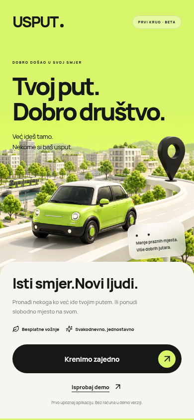
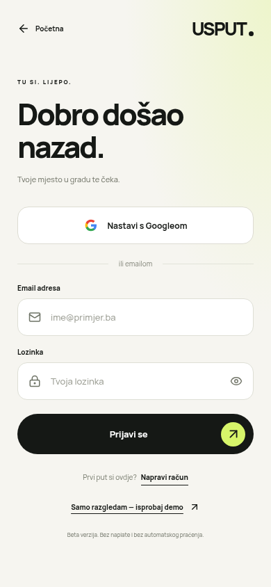
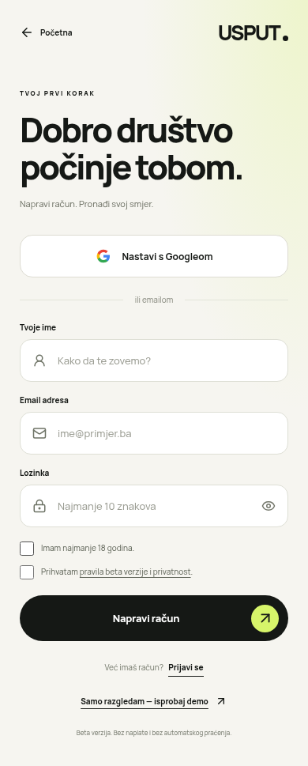
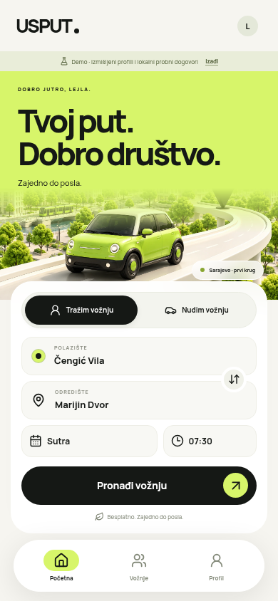
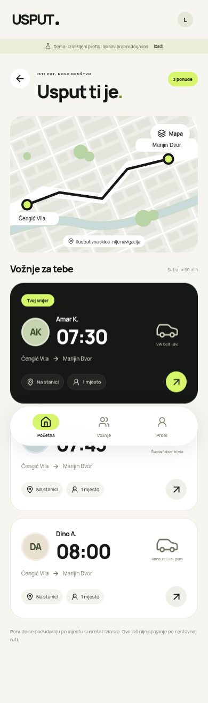
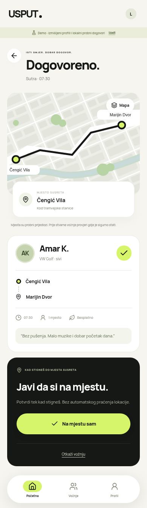
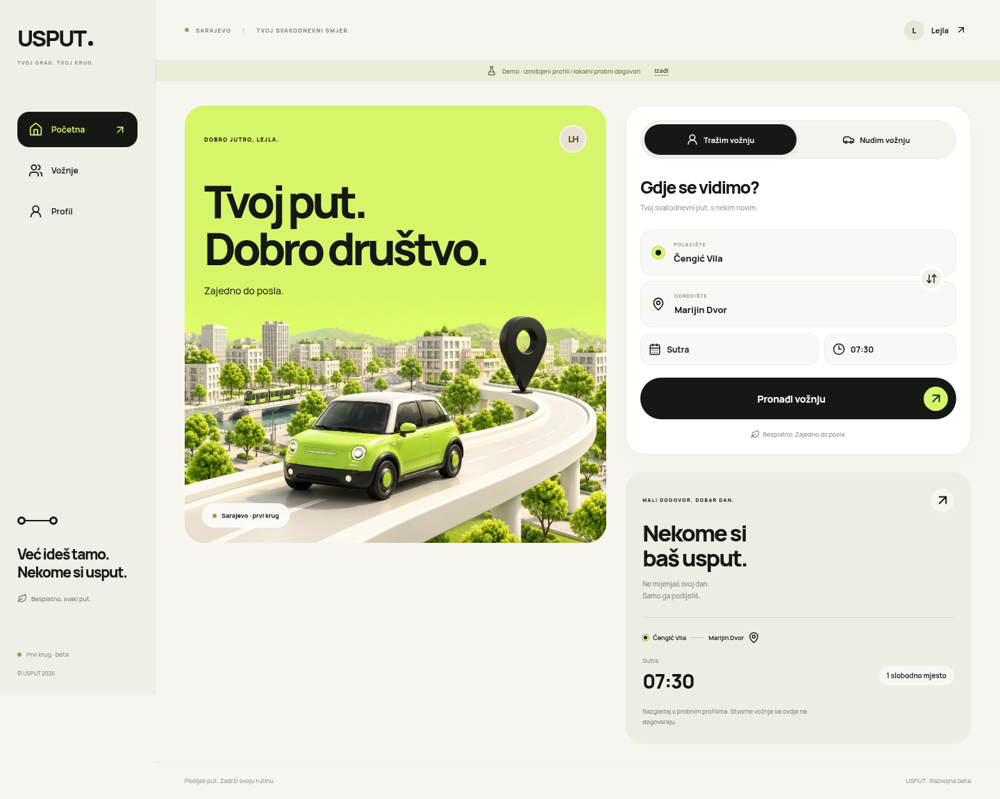

# USPUT · Pulse

**Tvoj put. Dobro društvo.** Razvojna web beta za svakodnevni gradski put do posla.

Implementacija je u [`app/`](app/README.md). Originalni projektni materijali i odabrani mockupi ostaju sačuvani. Ova grana dodaje prvu povezanu aplikaciju. Testna web adresa: https://usput-pulse.salemko.workers.dev (razvojna beta, nije za organizaciju stvarnih vožnji).

## Šta radi

- Splash / uvod, email registracija, prijava, sigurne sesije i odjava.
- Obavezna prijava/registracija, BHS/ENG interfejs i evropski izbor datuma/vremena.
- Glavni ekran putnika/vozača, objava i pretraga ponuda, detalji rute.
- Zahtjev putnika → prihvatanje vozača → spremnost → završetak ili otkazivanje.
- Moje vožnje, profil i sačuvano vozilo s pretragom 640 marki/modela i izborom boje.
- Trajna lokalna SQLite baza i isti API za Cloudflare Worker/D1.
- Google OAuth tok je implementiran i testiran na granici protokola; stvarna Google prijava čeka OAuth podatke vlasnika. [Upute za povezivanje](app/GOOGLE-PRIJAVA.md).

## Stvarni ekrani aplikacije

<table><tr><td></td><td></td><td></td></tr><tr><td></td><td></td><td></td></tr></table>



Slike su snimci implementacije, ne novi generisani mockupi. Profili na snimcima su demo podaci.

## Pokretanje

```bash
cd app
npm ci --cache /tmp/usput-npm-cache
npm run build
npm start
```

Node 24. Detalji, testovi i Cloudflare upute: [app/README.md](app/README.md).

**Granice:** odabrana probna mjesta susreta, bez cestovnog rutiranja/GPS-a, bez naplate i push/SMS obavijesti. Skica i opcionalni OpenStreetMap pregled nisu navigacija. Beta još nije odobrena za stvarne vožnje; potrebni su operativni i pravni koraci iz [plana projekta](USPUT-plan-v0.3.md).
